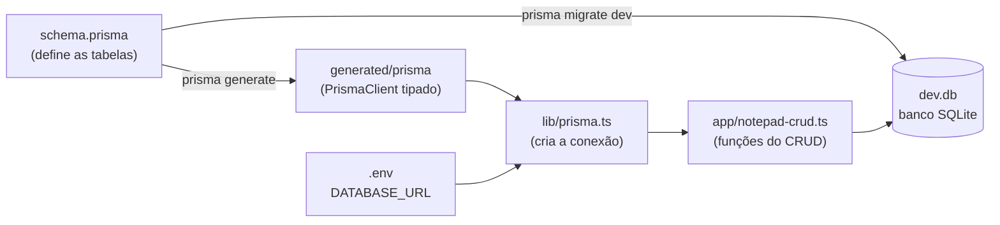

# 📝 Notepads CRUD

Aplicação de **anotações** com CRUD completo (criar, listar, editar e deletar), feita com **Next.js 16**, **React 19**, **Prisma 7** e **SQLite**, estilizada com **Tailwind CSS**.

---

## 📦 Versões utilizadas

Versões exatas instaladas, conforme o `package-lock.json`:

| Pacote | Versão | Tipo |
| --- | --- | --- |
| `next` | 16.4.2 | dependência |
| `react` / `react-dom` | 19.3.0 | dependência |
| `@prisma/client` | 7.10.1 | dependência |
| `@prisma/adapter-better-sqlite3` | 7.10.1 | dependência |
| `better-sqlite3` | 12.11.1 | instalado junto com o adapter |
| `dotenv` | 18.0.8 | dependência |
| `react-toastify` | 11.1.0 | dependência |
| `prisma` (CLI) | 7.10.1 | dev |
| `tailwindcss` / `@tailwindcss/turbopack` | 4.3.3 | dev |
| `typescript` | 5.9.3 | dev |
| `eslint` | 9.39.5 | dev |
| `eslint-config-next` | 16.4.2 | dev |
| `tsx` | 4.23.15 | dev |
| `@types/node` | 20.19.43 | dev |
| `@types/react` / `@types/react-dom` | 19.3.0 | dev |
| `@types/better-sqlite3` | 9.6.0 | dev |

> Node.js usado no desenvolvimento: **v24.18.0**.

---

## 🚀 Como rodar o projeto

**Pré-requisito:** Node.js 20 ou superior (usado: v24.18.0).

```bash
# 1. Instalar as dependências nas versões exatas do package-lock.json
npm ci

# 2. Criar o arquivo .env com o caminho do banco
echo 'DATABASE_URL="file:./dev.db"' > .env

# 3. Criar as tabelas no banco (aplica as migrations)
npx prisma migrate dev --config prisma7.config.ts

# 4. Gerar o Prisma Client
npx prisma generate --config prisma7.config.ts

# 5. Rodar o servidor
npm run dev
```

Depois, abra **http://localhost:3000**.

> ⚠️ O Prisma procura por padrão um arquivo `prisma.config.ts`. Como aqui o nome é `prisma7.config.ts`, é preciso passar `--config prisma7.config.ts`.

---

## 🆕 Como criar um projeto novo do zero (Next.js + Prisma + SQLite)

Passo a passo para montar um projeto igual a este, **com as mesmas versões** do `package-lock.json`.

### 1. Criar o projeto Next.js (versão 16.4.2)

```bash
npx create-next-app@16.4.2 meu-projeto --ts --tailwind --eslint --app --no-src-dir --import-alias "@/*" --use-npm
cd meu-projeto
```

Para garantir as mesmas versões de Next, React, Tailwind, TypeScript e ESLint:

```bash
npm install --save-exact next@16.4.2 react@19.3.0 react-dom@19.3.0
npm install -D --save-exact tailwindcss@4.3.3 typescript@5.9.3 eslint@9.39.5 eslint-config-next@16.4.2 \
  @types/node@20.19.43 @types/react@19.3.0 @types/react-dom@19.3.0
```

### 2. Instalar o Prisma, o adapter do SQLite e as outras bibliotecas

```bash
# Dependências de desenvolvimento (CLI do Prisma e tipos)
npm install -D --save-exact prisma@7.10.1 @types/better-sqlite3@9.6.0 tsx@4.23.15

# Dependências da aplicação
npm install --save-exact @prisma/client@7.10.1 @prisma/adapter-better-sqlite3@7.10.1 dotenv@18.0.8 react-toastify@11.1.0
```

> ⚠️ `prisma`, `@prisma/client` e `@prisma/adapter-better-sqlite3` precisam estar **sempre na mesma versão** (aqui, 7.10.1).
>
> `--save-exact` grava a versão exata (`7.10.1`) no `package.json`, em vez de `^7.10.1`.

### 3. Inicializar o Prisma

```bash
npx prisma init --datasource-provider sqlite --output ../generated/prisma
```

Esse comando cria:
- `prisma/schema.prisma` → onde você define as tabelas;
- `prisma.config.ts` → configuração do Prisma CLI;
- `.env` → com a variável `DATABASE_URL`.

Confira se o `.env` ficou assim:
```env
DATABASE_URL="file:./dev.db"
```

E adicione a pasta gerada ao `.gitignore`:
```
/generated/prisma
```

### 4. Criar o modelo no `prisma/schema.prisma`

```prisma
generator client {
  provider = "prisma-client"
  output   = "../generated/prisma"
}

datasource db {
  provider = "sqlite"
}

model Notepad {
  id          Int    @id @default(autoincrement())
  title       String
  description String
}
```

### 5. Criar a tabela no banco e gerar o client

```bash
npx prisma migrate dev --name init
npx prisma generate
```

Como aqui o arquivo se chama `prisma.config.ts` (o nome padrão), não é preciso usar `--config`.

### 6. Criar a conexão em `lib/prisma.ts`

```ts
import "dotenv/config";
import { PrismaBetterSqlite3 } from "@prisma/adapter-better-sqlite3";
import { PrismaClient } from "../generated/prisma/client";

const adapter = new PrismaBetterSqlite3({ url: `${process.env.DATABASE_URL}` });
const prisma = new PrismaClient({ adapter });

export { prisma };
```

### 7. Usar o Prisma numa Server Action (ex: `app/notepad-crud.ts`)

```ts
"use server";

import { prisma } from "@/lib/prisma";

export async function listNotepads() {
  return prisma.notepad.findMany();
}

export async function createNotepad(title: string, description: string) {
  await prisma.notepad.create({ data: { title, description } });
}
```

### 8. Mostrar os dados numa página (ex: `app/page.tsx`)

```tsx
import { listNotepads } from "./notepad-crud";

export default async function Home() {
  const notepads = await listNotepads();

  return (
    <ul>
      {notepads.map((n) => (
        <li key={n.id}>{n.title}</li>
      ))}
    </ul>
  );
}
```

### 9. Rodar

```bash
npm run dev
```

> 💡 **Resumo do fluxo:** `create-next-app` → instalar pacotes → `prisma init` → escrever o `model` → `migrate dev` → `generate` → criar `lib/prisma.ts` → usar `prisma.modelo.metodo()` em funções com `"use server"`.

---

## 🗂️ Estrutura de pastas

```
notepads-crud/
├── app/
│   ├── layout.tsx                 # Layout de todas as páginas (header + ToastContainer)
│   ├── page.tsx                   # Rota "/" → mostra a lista de anotações
│   ├── notepads-list.tsx          # Componente que busca e lista as anotações
│   ├── criar-anotacao/page.tsx    # Rota "/criar-anotacao"
│   ├── create-notepad-form.tsx    # Formulário de criação
│   ├── editar-anotacao/[id]/page.tsx  # Rota dinâmica "/editar-anotacao/:id"
│   ├── edit-notepad-form.tsx      # Formulário de edição e exclusão
│   ├── notepad-crud.ts            # ⭐ Funções do CRUD (usam o Prisma)
│   └── globals.css                # Estilos globais + Tailwind
│
├── lib/
│   └── prisma.ts                  # ⭐ Cria a conexão com o banco (PrismaClient)
│
├── prisma/
│   ├── schema.prisma              # ⭐ Define as tabelas do banco
│   └── migrations/                # ⭐ Histórico de alterações do banco (SQL)
│
├── generated/prisma/              # ⭐ Código gerado pelo `prisma generate` (não editar)
├── public/                        # Imagens estáticas (ex: notepad.png)
│
├── .env                           # ⭐ DATABASE_URL (endereço do banco)
├── dev.db                         # ⭐ O banco SQLite (um único arquivo)
├── prisma7.config.ts              # ⭐ Configuração do Prisma CLI
├── next.config.ts                 # Configuração do Next.js
├── tsconfig.json                  # Configuração do TypeScript (inclui o atalho "@/")
└── package.json                   # Dependências e scripts
```

Os itens com ⭐ têm relação com o **Prisma** e estão explicados abaixo.

---

## 🔷 Prisma: o que é e como está sendo usado

O **Prisma** é um **ORM** (*Object-Relational Mapping*). Em vez de escrever SQL na mão, você acessa o banco com código TypeScript:

```ts
// Sem Prisma (SQL puro)
SELECT * FROM Notepad;

// Com Prisma
prisma.notepad.findMany();
```

### Como as peças se conectam



---

### 1️⃣ `prisma/schema.prisma`: o modelo do banco

```prisma
generator client {
  provider = "prisma-client"
  output   = "../generated/prisma"
}

datasource db {
  provider = "sqlite"
}

model Notepad {
  id          Int    @id @default(autoincrement())
  title       String
  description String
}
```

| Trecho | Significado |
| --- | --- |
| `generator client` | Diz ao Prisma para **gerar o client** (o código que acessa o banco) |
| `output = "../generated/prisma"` | Pasta onde o client será gerado |
| `datasource db` / `provider = "sqlite"` | Tipo de banco usado (SQLite). No Prisma 7, a URL **não fica mais aqui**: ela vai para o `prisma7.config.ts` |
| `model Notepad { ... }` | Cria a **tabela** `Notepad`. No código, ela é acessada como `prisma.notepad` |
| `id Int @id` | Coluna inteira e **chave primária** |
| `@default(autoincrement())` | O banco gera o id sozinho: 1, 2, 3... |
| `title String` / `description String` | Colunas de texto obrigatórias. Para torná-las opcionais, seria `String?` |

---

### 2️⃣ `.env` e `prisma7.config.ts`: onde está o banco

**`.env`**
```env
DATABASE_URL="file:./dev.db"
```
`file:./dev.db` aponta para o arquivo `dev.db` na raiz do projeto. Esse arquivo **é** o banco inteiro.

**`prisma7.config.ts`** (usado pelos comandos `npx prisma ...`)
```ts
import "dotenv/config";                       // carrega o .env
import { defineConfig } from "prisma/config";

export default defineConfig({
  schema: "prisma/schema.prisma",             // onde está o schema
  migrations: { path: "prisma/migrations" },  // onde salvar as migrations
  datasource: { url: process.env["DATABASE_URL"] }, // URL do banco
});
```

---

### 3️⃣ `prisma/migrations/`: histórico do banco

Toda vez que você altera o `schema.prisma` e roda `npx prisma migrate dev`, o Prisma:
1. compara o schema com o banco;
2. gera um arquivo **SQL** numa nova pasta em `migrations/`;
3. executa esse SQL no banco.

Funciona como um "Git do banco de dados". Histórico deste projeto:

| Migration | O que fez |
| --- | --- |
| `..._init` | Criou a tabela `Post` (id, title, description) |
| `..._removeu_a_descricao` | Removeu a coluna `description` |
| `..._adicionei_a_descricao` | Adicionou `description` de volta |
| `..._muda_nome_pra_notepad` | Apagou `Post` e criou a tabela `Notepad` |

Exemplo do SQL gerado:
```sql
CREATE TABLE "Notepad" (
    "id" INTEGER NOT NULL PRIMARY KEY AUTOINCREMENT,
    "title" TEXT NOT NULL,
    "description" TEXT NOT NULL
);
```

---

### 4️⃣ `generated/prisma/`: o client gerado

Criado pelo `npx prisma generate`. É o código TypeScript feito sob medida para o seu schema. É por causa dele que `prisma.notepad.create(...)` tem **autocomplete e checagem de tipos**.

> Sempre que alterar o `schema.prisma`, rode `prisma generate` de novo (o `migrate dev` costuma fazer isso automaticamente). A pasta está no `.gitignore`, porque pode ser recriada a qualquer momento.

---

### 5️⃣ `lib/prisma.ts`: a conexão

```ts
import "dotenv/config";
import { PrismaBetterSqlite3 } from "@prisma/adapter-better-sqlite3";
import { PrismaClient } from "../generated/prisma/client";

const connectionString = `${process.env.DATABASE_URL}`;

const adapter = new PrismaBetterSqlite3({ url: connectionString });
const prisma = new PrismaClient({ adapter });

export { prisma };
```

| Linha | Significado |
| --- | --- |
| `import "dotenv/config"` | Carrega o `.env` para dentro de `process.env` |
| `import { PrismaClient } from "../generated/prisma/client"` | Importa o client **gerado** (no Prisma 7, não vem mais de `@prisma/client`) |
| `new PrismaBetterSqlite3({ url })` | Cria o **Driver Adapter**: o "driver" que conversa de fato com o SQLite. É obrigatório no Prisma 7 |
| `new PrismaClient({ adapter })` | Cria o objeto `prisma`, usado para fazer as consultas |
| `export { prisma }` | Permite que outros arquivos importem com `import { prisma } from "@/lib/prisma"` |

---

### 6️⃣ `app/notepad-crud.ts`: as operações do CRUD

O `"use server"` no topo faz essas funções rodarem **no servidor**, onde o Prisma tem acesso ao banco. Mesmo assim, os formulários (que rodam no navegador) conseguem chamá-las diretamente.

```ts
// READ: todas
prisma.notepad.findMany();

// READ: uma pelo id (lança erro se não encontrar)
prisma.notepad.findFirstOrThrow({ where: { id } });

// CREATE
prisma.notepad.create({ data: { title, description } });

// UPDATE
prisma.notepad.update({ data: { title, description }, where: { id } });

// DELETE
prisma.notepad.delete({ where: { id } });
```

| Prisma | SQL equivalente |
| --- | --- |
| `findMany()` | `SELECT * FROM Notepad` |
| `findFirstOrThrow({ where: { id } })` | `SELECT * FROM Notepad WHERE id = ? LIMIT 1` |
| `create({ data })` | `INSERT INTO Notepad (title, description) VALUES (?, ?)` |
| `update({ data, where })` | `UPDATE Notepad SET title = ?, description = ? WHERE id = ?` |
| `delete({ where })` | `DELETE FROM Notepad WHERE id = ?` |

**Palavras-chave das consultas:**
- `where` → filtro (equivale ao `WHERE` do SQL)
- `data` → valores que serão gravados
- Todas as funções retornam uma **Promise**, por isso usamos `await`.

Antes de `create` e `update`, as funções validam os dados (título com 4 a 64 caracteres, descrição com 8 a 256) e retornam `{ sucesso, mensagem }` para o formulário mostrar um toast.

---

### 🛠️ Comandos do Prisma

| Comando | O que faz |
| --- | --- |
| `npx prisma migrate dev --config prisma7.config.ts` | Aplica as migrations / cria uma nova depois de alterar o schema |
| `npx prisma migrate dev --name nome --config prisma7.config.ts` | Cria uma migration com um nome |
| `npx prisma generate --config prisma7.config.ts` | Gera o client em `generated/prisma/` |
| `npx prisma studio --config prisma7.config.ts` | Abre uma interface visual para ver e editar os dados |
| `npx prisma migrate reset --config prisma7.config.ts` | ⚠️ Apaga o banco e recria do zero |

### 🧯 Erros comuns

| Erro | Solução |
| --- | --- |
| `Cannot find module '../generated/prisma/client'` | Rodar `prisma generate` |
| `The table main.Notepad does not exist` | Rodar `prisma migrate dev` |
| Banco `undefined` / não conecta | Criar o `.env` com `DATABASE_URL` |

---

### ❓ Revisão rápida

- **Qual a diferença entre `migrate dev` e `generate`?** O `migrate dev` altera o **banco** (tabelas). O `generate` gera o **código** TypeScript do client.
- **Onde ficam os dados?** No arquivo `dev.db`, apontado pelo `DATABASE_URL` do `.env`.
- **Como criar uma tabela nova?** Adicionar um `model` no `schema.prisma` e rodar `prisma migrate dev`.
- **O que é o Driver Adapter?** O pacote que faz a conexão real com o banco (aqui, `better-sqlite3`). No Prisma 7, ele é passado para o `new PrismaClient({ adapter })`.
- **Por que o Prisma só é usado em arquivos com `"use server"`?** Porque o acesso ao banco precisa acontecer no servidor. O navegador não tem acesso ao `dev.db`.
